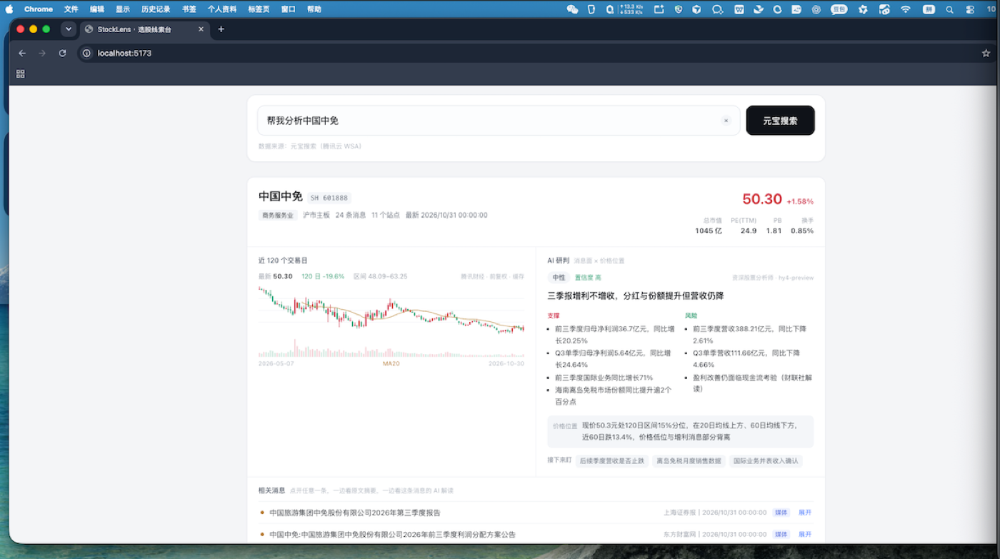
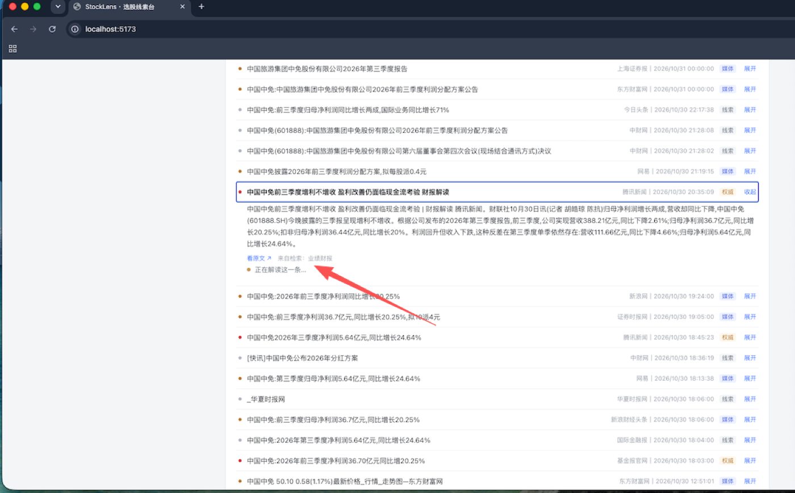

# StockLens · 选股线索看板

用元宝搜索（腾讯云 WSA）把公开网页信息聚合成一份**可核查的选股线索清单**：输入一句话，拿到一批候选标的，每个标的都能展开到原文链接与日期，并可对这一份名单继续追问收窄。

React 前端 + Node.js 后端，SSE 流式返回。打分与结论只来自元宝搜索返回的公开页面；现价、市值、PE 与日 K 线仅用于筛选和展示，来自公开行情接口，**不参与打分**。

> 本工具仅用于信息检索与研究，不构成任何投资建议。

## 界面



*输入「请分析中国中免」→ 行情条 + 120 日日 K + AI 综合研判 + 消息列表，4.7 秒出结果*



*24 条来源逐条展开，点开单条才调用模型解读这一条*

---

## 快速开始

```bash
git clone https://github.com/18507493828/yuanbaoshousuo.git
cd yuanbaoshousuo
npm install
cp .env.example .env      # 填 WSA_API_KEY，或 WSA_SECRET_ID + WSA_SECRET_KEY

# 在 .env 里填服务 API KEY（腾讯云控制台 → 元宝搜索 → 服务 API KEY，sk- 开头）
# 也可以填 WSA_SECRET_ID + WSA_SECRET_KEY 走 TC3 签名
npm run doctor     # 联通性自检，会真实调一次接口
npm run dev        # 前端 http://localhost:5173，后端 http://localhost:8787
```

生产模式：

```bash
npm run build && npm start   # 单端口 8787 托管前端与 API
```

`.env` 两种鉴权写一组即可，都配时优先用 API KEY（权限只限元宝搜索，泄露影响面小）。

语义提炼是可选层：不填 `HY4_API_KEY` 时全程走本地规则，功能完整可用；填了之后每轮扫描会多调一次混元 Hy4 preview，把前 `HY4_TOP_N` 个候选的证据摘要提炼成事件类型、事实要点和风险点。

```ini
HY4_API_KEY=                                            # 不填则关闭这一层
HY4_BASE_URL=https://tokenhub.tencentmaas.com/v1        # 腾讯云 TokenHub
HY4_MODEL=hy4-preview
HY4_THINKING=disabled                                   # 必须关，见下方说明
HY4_REASONING_EFFORT=low                                # 仅在 THINKING=enabled 时生效
HY4_TIMEOUT_MS=30000
HY4_TOP_N=6                                             # 每轮最多提炼几个候选
HY4_PERSONA=master                                      # 默认分析角色，页面可切换
```

`HY4_THINKING` 要保持 `disabled`。hy4-preview 默认开启深度思考，实测思考过程会把 `max_tokens` 全部吃光，`content` 返回空串（耗时从 3.4 秒涨到 38 秒），语义层会静默降级。代码在这种情况下会明确报出「输出被 max_tokens 截断」，不会让你猜。

Key 在 [TokenHub 控制台 → API Key 管理](https://console.cloud.tencent.com/tokenhub/apikey) 创建，创建后只显示一次。

---

## 它到底做了什么

输入是一句话，输出是一张能逐条核对的名单。中间每一步都能单独看：

**0. 一句话 → 检索计划**
「近一个月半导体设备里订单大增、市值 100-500 亿的公司，给我 10 家」这句话里有五件事：主题、角度、时间、筛选、条数。`planner.js` 把它们拆出来，界面上会逐条显示「理解成了什么」，拆错了能立刻看出来。规则解析先跑（快、可解释），拆不动才交给模型。

**1. 策略 → 检索式**
六个预设角度：业绩预增、订单中标、机构动向、产品涨价、回购增持、主题扫描。每个角度展开 3 条检索式，示例（主题 = `AI 算力`，角度 = 业绩预增）：

```
AI 算力 业绩预增 公告 2026
AI 算力 三季报 业绩预增 名单
AI 算力 净利润 同比增长 超预期
```

同一个主题换角度，筛出来的公司完全不同 —— 这是「信息角度」而不是「筛选条件」的原因：元宝搜索能回答的是「公开信息里有什么」，不是「按 PE 帮我排序」。

**2. 检索 → 抽标的**
对每条结果的标题、摘要、正文片段做三件事：

- 抽 A 股代码（含市场与板块判定，排除 `202610` 这类日期和 `884092` 这类行业指数）
- 抽名称（`宁德时代(300750)`、`宁德时代 300750`、`300750 宁德时代` 三种写法都覆盖；标题里切出来的「预计净利翻倍」这类短语会被停用词挡掉，宁可不识别也不猜）
- 抽信号词（正面 7 类、负面 3 类）

信号**按代码所在的那一句**取，不按整页取。列表型文章里「300620 预计净利翻倍……300395 净利润下滑」必须分别归到各自的公司，一句里有多只股票时再按逗号拆一层。

**3. 证据 → 打分**
同一只股票被越多独立站点提及、信源越权威、时间越新，分数越高；命中负面信号扣分。同一站点多篇文章只算一次，避免同源堆分。

```
信源权重 A=3 / B=2 / C=1  ×  时效系数（7 天内 1.3，一年以上 0.7）
+ 交叉印证（3 站 +2，5 站 +4）
+ 正面信号（每类 +0.8，上限 +4）
- 负面风险（每类 -1.5，上限 -4.5）
```

线索等级：`线索强`（≥10 分、≥3 站，且有权威来源，或全部来自主流财经媒体）／`线索中`（≥4.5 分、≥2 站）／`线索弱`。

**3.5 语义提炼（可选）**
规则能认出「净利润同比下滑」，认不出「利润承压」「毛利被挤压」，也读不出「在手订单 170.73 亿元，同比增 88.2%」意味着什么。配了 `HY4_API_KEY` 之后，前 N 个候选的证据摘要会交给混元 Hy4 preview，回来四样东西：

| 字段 | 含义 |
| --- | --- |
| `event` | 事件类型（业绩超预期 / 大额订单 / 产能扩张 / 风险事件…） |
| `points` | 摘要里支撑买入理由的具体事实，带数字 |
| `risks` | 摘要里出现的风险点 |
| `verdict` | 一句话说明这些信息共同指向什么，不给买卖结论 |

prompt 里写死三条约束：只能用传入摘要里的信息、有数字必须带数字、摘要不足时 `confidence` 必须给 `low`。模型挂了或返回的不是 JSON，这一条就退回规则结果，扫描流程不中断。

**3.6 分析角色**

同一份证据，不同角色读出来的东西不一样。「在手订单 170.73 亿元，同比增 88.2%」这一句：分析师看到的是业绩能见度，产业链研究员看到的是下游在扩产，量化经理先问口径是「在手」还是「已确认」，风控审查官想到的是订单不等于回款。

所以角色不只是换一段开场白，它还决定 `points` 和 `risks` 各写什么。四个角色共用同一套输出结构，页面左上角切换：

| 角色 | 视角 | points 侧重 | risks 侧重 |
| --- | --- | --- | --- |
| `master` 资深股票分析师 | 卖方研究 | 对业绩的影响 → 幅度 → 何时能验证 | 兑现条件、收入确认、成本、基数效应 |
| `industry` 产业链研究员 | 自上而下看链条 | 环节位置、下游是谁、份额与产能、价格传导 | 上游挤压、同行扩产、需求证伪、被替代 |
| `quant` 量化选股经理 | 只认可量化的 | 字段 + 取值 + 口径 | 口径不明、范围不一致、单期不可比 |
| `risk` 风控审查官 | 反向找漏洞 | 只写能独立核实的硬事实 | 单一来源、缺一手披露、隐性代价、表述模糊 |

四个角色的硬约束完全一致——只能用摘要里的信息、不给买卖建议、证据不足必须标 `low`。换角色只改变读法，不改变事实边界。

`.env` 里的 `HY4_PERSONA` 决定不带参数时的默认角色，页面上选中的角色优先。命令行可以单独试某个角色：

```bash
npm run doctor -- --persona=risk
```

**4. 报告**
导出 Markdown：候选清单表 + 每个标的的信号标签、语义提炼结论与证据原文（站点、日期、信源级别、链接）+ 本次使用的检索式。报告里会记下这次用的是哪个角色，同一组数据换角色重跑，可以得到四份角度不同的清单。

**5. 追问收窄（不重新检索）**
名单出来之后可以接着说「只看市值 200 亿以下」「排除 ST」「按涨幅排」。这句话被解析成一组过滤/排序操作，直接作用在**已有名单**上——背后的网页证据一条不动，只是在同一份结果里换个口径看。重新问一遍 AI 会换一批公司出来，上一轮看到的东西就断了；这里收窄前后是同一份数据，`21 → 6` 能对上号，也能撤销回上一版。

---

## 目录结构

```
server/
├── index.js              SSE 接口、检索缓存、静态托管
└── lib/
    ├── wsa.js            元宝搜索客户端（API KEY / TC3 双鉴权）
    ├── tc3.js            TC3-HMAC-SHA256 签名
    ├── planner.js        自然语言 → 检索计划；追问 → 收窄操作
    ├── strategies.js     策略 → 检索式
    ├── extract.js        代码 / 名称 / 信号抽取
    ├── score.js          证据聚合与排序
    ├── filters.js        股价 / 市值 / PE 区间、排除项、排序
    ├── quote.js          批量行情快照
    ├── kline.js          日 K 线（前复权）
    ├── profile.js        名称与行业档案
    ├── hy4.js            混元 Hy4 preview 语义提炼（可选）
    ├── personas.js       分析角色的设定与提示词片段
    ├── trust.js          信源分级规则
    └── report.js         Markdown 报告
web/
├── index.html
└── src/
    ├── App.jsx
    ├── api.js            SSE 客户端
    ├── lib/refine.js     在已有名单上继续收窄
    ├── styles.css
    └── components/       候选卡、K 线、图表
scripts/doctor.js         联通性自检
```

## 接口

| 方法 | 路径 | 说明 |
| --- | --- | --- |
| GET | `/api/health` | 密钥状态、鉴权方式、语义层是否启用 |
| GET | `/api/strategies` | 策略、主题预置与分析角色列表 |
| POST | `/api/search` | 单条检索，调试用 |
| POST | `/api/screen` | 选股扫描，SSE 流 |
| POST | `/api/refine` | 把一句追问解析成对现有名单的调整操作 |
| GET | `/api/kline` | 日 K 线，`code` + `market`（SH/SZ/BJ）+ 可选 `days`（20–250，默认 120） |
| POST | `/api/profile` | 批量取名称与行业，请求体 `{ "items": [{ "code": "688082", "market": "SH" }] }` |
| POST | `/api/report` | 导出 Markdown |

`/api/screen` 请求体，一句话即可：

```json
{ "query": "近一个月半导体设备里订单大增、市值 100-500 亿的公司，给我 10 家" }
```

这句话会被 `planner.js` 拆成结构化参数（下面是一次真实解析的结果）：

```json
{
  "topic": "半导体设备",
  "strategies": ["orders"],
  "freshness": "m1",
  "limit": 10,
  "filters": { "capMin": 100, "capMax": 500 },
  "exclude": [],
  "sort": "score",
  "extraQueries": ["半导体设备 订单大增 近一个月"],
  "intent": "找近一月半导体设备订单大增的中市值公司"
}
```

解析优先级：规则先跑一遍，主题词命中词库且句子不长时直接出结果（不花模型时间）；句子长、或主题词不在词库里，再交给 Hy4 解析。模型不可用、超时、输出不合规时一律退回规则结果，同时带上 `plannerError` 说明原因。

也兼容结构化写法：

```json
{ "topic": "AI 算力", "strategies": ["earnings", "orders"], "persona": "master", "freshness": "m3", "cnt": 30, "filters": { "capMin": 50, "capMax": 200, "peMax": 30 } }
```

`filters` 可选，三类区间：`priceMin`/`priceMax`（股价，元）、`capMin`/`capMax`（总市值，亿元）、`peMin`/`peMax`（市盈率 TTM）。设了哪个区间就只保留落在区间内的标的；区间写反会自动纠正。亏损股（PE ≤ 0）与停牌（无现价）在设了对应条件时一律排除——拿不到有效数值就没法判断是否满足条件。不传或全空则不筛。

`strategies` 是数组，可以多选：每个角度出 3 条检索式，多选时一并跑，同一条检索式不会重复请求；单次扫描上限 20 条检索式，接口侧并发压到 4。也兼容旧的单值写法 `"strategy": "earnings"`。

`persona` 取 `master` / `industry` / `quant` / `risk`，不传时用 `HY4_PERSONA` 或默认 `master`。

SSE 事件：`plan_start`（开始解析）→ `plan`（解析出的检索计划）→ `meta`（检索式清单与本次角色）→ `query`（每条检索式的命中数、抽出标的数、耗时）→ `candidates`（规则算出的候选列表，先上屏）→ `enrich_start` / `enrich`（逐条补语义结论，未配置模型时不出现）→ `done`（最终候选列表与汇总）。用结构化写法时不出现 `plan_start` / `plan`。

`/api/refine` 请求体：`{ "query": "只看市值 300 亿以下，按涨幅排", "plan": { ... }, "candidates": [ ... ] }`，返回：

```json
{ "ops": { "filters": { "capMax": 300 }, "sort": "gainers", "limit": null, "exclude": [], "keep": [], "drop": [], "note": "只看市值300亿以下并按涨幅排" }, "note": "..." }
```

`ops` 为 `null` 时表示这句话不是对名单的调整（比如问「这家公司怎么样」），前端提示换说法。**收窄不重新检索**：名单背后的网页证据不动，只是换个口径看同一份结果，所以上一轮看到的标的不会因为追问而换掉。

---

## 设计取舍

**行情用来筛选和定位，不参与打分。** 现价、涨跌幅、总市值、流通市值、市盈率、市净率来自一次批量行情快照（腾讯行情，5 分钟缓存），既是筛选条件的依据，也直接显示在候选卡上；日 K 线（前复权，近 120 个交易日）走同一个代理层，腾讯财经为主、东方财富兜底。两者都不进入打分公式——分数只反映「公开信息里这只票被说得多厚」，开不开筛选、看不看 K 线，都是同一套排序。模型不碰这一层：文本模型拼不出真实价格，行情只能是真实接口给的数。

**不做行业映射表。** 不从主题词反推「AI 算力包含哪些公司」——那种映射表写死了就必然过时，而且容易把不相关的公司硬塞进去。标的只从检索结果原文里出现过的代码来。

**名称宁缺勿错。** 识别不出来就退回显示代码，不用标题里的短语凑。选股场景里一个错名字比少一条线索代价大。

**同源不堆分。** 10 篇文章都来自同一个站点，只算 1 个信源。这条规则让「线索强」不至于被转载稿刷出来。

## 已知限制

- 信号来自标题与摘要的关键词命中，**没有读公告原文**。命中「预增」不等于真的预增，报告里每条都给了链接，需要自己点回去核。
- 行情是快照口径，非逐笔实时：PE 用的是腾讯的 TTM 口径，亏损股为负值；停牌或当日无成交时价格为 0，这类标的在设了股价/市值/PE 条件时会被排除。
- 语义提炼同样只看摘要，摘要写得不清楚时它也只能给 `low` 置信度，不会替你把话说满。
- 换角色只改变语义层的读法与措辞，**不改变候选名单、打分和排序**——那部分由规则引擎决定。同一组数据切四个角色，出来的是四份角度不同的注释，不是四份不同的名单。
- 元宝搜索返回的正文片段长短不一，长文里的表格型名单可能抽不全。
- 摘要型结果里代码与名称常常只出现一个，此时会出现「有代码无名称」的条目。
- 检索式是按 A 股常见表述写的，港美股、ETF、可转债都不在范围内。
- 追问只在已有名单上收窄：首次搜索时被筛掉的标的（例如设了市值上限）不会因为追问「放宽到 1000 亿」而回来，那种情况要重新搜一次。
- 结果缓存 10 分钟，同一条检索式重复跑不会重复计费。

---

## 数据来源

| 用途 | 接口 |
| --- | --- |
| 网页检索 | 腾讯云元宝搜索 WSA `SearchPro` |
| 语义提炼 / 个股研判 | 腾讯云 TokenHub `hy4-preview`（可选，不配置则全程走规则） |
| 行情快照 | 腾讯 `qt.gtimg.cn` 批量接口，5 分钟缓存 |
| 日 K 线 | 腾讯财经 → 新浪财经 → 东方财富，三源降级，10 分钟缓存 |
| 名称与行业 | 东方财富 `push2/clist`，巨潮兜底 |

## 免责声明

本项目仅用于公开信息检索与技术研究，不构成任何投资建议。文中与界面上的所有结论都来自公开网页摘要与公开行情接口，未经过人工核实，使用前请自行点回原文核对。

## 许可

MIT License，见 [LICENSE](LICENSE)。
